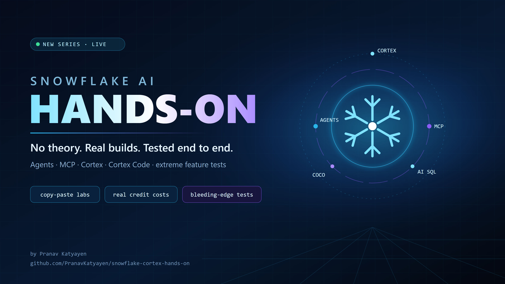

# Snowflake Cortex Hands-On



Copy-paste labs for Snowflake's AI features: Cortex AI Functions, Cortex Search, Cortex Analyst, Cortex Agents, Cortex Code, MCP and more.

Every lab is:
- **Tested end to end** in a real account before it is published, with the date, region and edition stated.
- **Re-runnable**: it uses `CREATE OR REPLACE` throughout and comes with a cleanup script.
- **Cost-aware**: each lab states how many credits it actually used.

## Episodes

| # | Lab | What you build | Credits |
|---|---|---|---|
| 1 | [Snowflake-managed MCP server](episodes/01-mcp-server) | Claude and Cursor answer "why did sales drop?" from governed Snowflake data, using a Cortex Agent, Analyst, Search and a custom tool | ~0.3–0.5 |

## Before any lab

1. **Self-service trial?** Cortex AI features are disabled by default. Add a credit card in Snowsight under *Admin → Billing* to enable them. The trial continues.
2. **Check model availability in your region:** run [`tools/models.sql`](tools/models.sql). If the models you need aren't hosted in your region, an ACCOUNTADMIN can enable cross-region inference:
   ```sql
   ALTER ACCOUNT SET CORTEX_ENABLED_CROSS_REGION = 'ANY_REGION';
   ```
3. **Use the `AI_*` functions** (`AI_COMPLETE`, `AI_CLASSIFY`, ...). New accounts are blocked from the legacy `SNOWFLAKE.CORTEX.*` functions.

---
*Independent tutorials, not an official Snowflake publication. Found a step that broke? Open an issue.*
