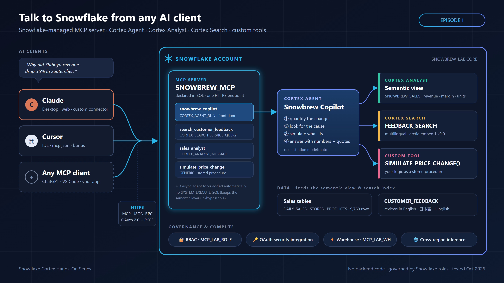

# Episode 1: Snowflake-managed MCP server

Ask Claude or Cursor *"Why did our Shibuya store lose 36% of its revenue?"* and get an answer from Snowflake, with no backend code.

## Files

| File | Run where | What it does |
|---|---|---|
| [`lab.sql`](lab.sql) | Snowsight worksheet → **Run All** | Creates the role, warehouse, demo data, Cortex Search, semantic view, price-simulator procedure, Cortex Agent and the MCP server |
| [`clients.sql`](clients.sql) | Snowsight worksheet | Creates OAuth integrations for Claude and Cursor, and prints your client ID and MCP URL |
| [`test_mcp.ps1`](test_mcp.ps1) | PowerShell (optional) | Tests the MCP server directly with a programmatic access token, without any AI client |
| [`cleanup.sql`](cleanup.sql) | Snowsight worksheet | Removes everything the lab created |

## Quick start

1. Run `lab.sql`. The final checks should show Shibuya revenue going from **61,599.10** in August to **39,131.20** in September.
2. Run `clients.sql`, then copy the `OAUTH_CLIENT_ID` value and the MCP URL from its output.
3. In Claude, go to **Settings → Connectors → Add custom connector**:
   - **URL:** your MCP URL
   - **Authentication:** Sign in now
   - **OAuth client:** Use your own OAuth client
   - **Client ID:** your client ID. Leave the secret blank.
4. Ask:
   - *Which store had the biggest revenue drop in September vs August 2026, and why?*
   - *What are customers in London complaining about?*
   - *If we raise the Cold Brew price by 8%, what happens to revenue and margin?*
5. When you're done, run `cleanup.sql`.

## Gotchas

- OAuth blocks `ACCOUNTADMIN`, `SECURITYADMIN` and `ORGADMIN`. Your default role must be a non-admin role; `clients.sql` sets it for you.
- Use hyphens, not underscores, in the account host name of the MCP URL.
- A semantic view fact can only reference columns from its own table.
- On its own, the `CORTEX_ANALYST_MESSAGE` tool returns SQL but doesn't run it. The agent runs the SQL and returns answers.

**Tested:** 29 Oct 2026 · AWS ap-northeast-1 · Enterprise edition · Claude Desktop
