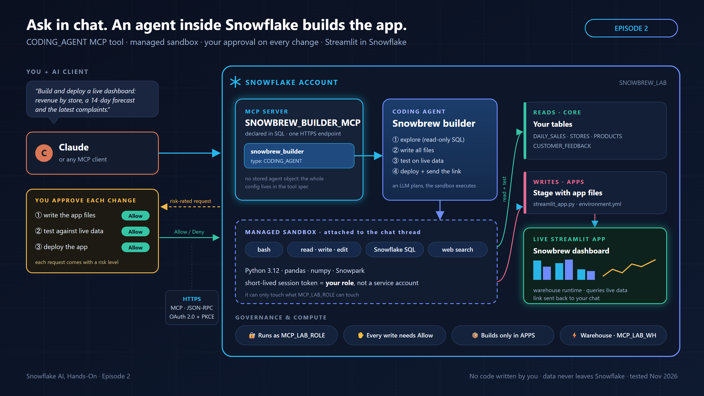

# Episode 2: a coding agent inside Snowflake

Send one message in Claude, and an agent running inside Snowflake writes, tests and deploys a live Streamlit app. It works under your role and asks before every change.

**Standalone:** you don't need Episode 1.

**Did Episode 1?**
1. Run `setup.sql`. Existing objects are skipped.
2. In Claude, add a **second** connector with the new URL (ending in `SNOWBREW_BUILDER_MCP`) and your **same** client ID.
3. Continue from Quick start step 3.

## Files

| File | Run where | What it does |
|---|---|---|
| [`setup.sql`](setup.sql) | Snowsight worksheet → **Run All** | Creates (if missing) the role, warehouse, demo data, `SNOWBREW_LAB.APPS` schema and Claude OAuth client, plus the `SNOWBREW_BUILDER_MCP` server with one `CODING_AGENT` tool. Prints your client ID and MCP URL. |
| [`cleanup.sql`](cleanup.sql) | Snowsight worksheet | A) drops everything the agent built and the builder server. B) commented out: removes all lab objects. |

## Quick start

1. Run `setup.sql`, then copy the `OAUTH_CLIENT_ID` value and the MCP URL from its output.
2. In Claude, go to **Settings → Connectors → Add custom connector**:
   - **URL:** your MCP URL
   - **Authentication:** Sign in now
   - **OAuth client:** Use your own OAuth client
   - **Client ID:** your client ID. Leave the secret blank.
3. In the connector's tool list, set **Snowbrew builder** to **Always allow**. Snowflake still asks before every command that changes something.
4. In a new chat, send:
   > *Use snowbrew_builder to build and deploy a live Streamlit dashboard for Snowbrew inside Snowflake: August vs September revenue by store, a 14-day forecast with a store picker, and the latest customer complaints for the selected store. Give me the link.*
5. Click **Allow** about 3 times, then open the link it gives you.

## Gotchas

- New accounts create Streamlit apps on the **container runtime** by default, even though the `CREATE STREAMLIT` docs still say the warehouse runtime is the default. An app built with `environment.yml` then fails with *"pyproject.toml file does not exist"*. The builder's instructions set `RUNTIME_NAME = 'SYSTEM$WAREHOUSE_RUNTIME'` to avoid this.
- The agent's sandbox has newer libraries than the app runtime, so code can pass its tests and still fail in the app (for example Altair's `xOffset`). The instructions pin `streamlit=1.42.0` and use only Streamlit's built-in charts.
- Each command that changes something waits for your click, so the instructions tell the agent to work in 3 steps: write the files, test, deploy.
- The agent runs as **your** role: its Python opens a Snowpark session with your session token. That role's grants decide what it can touch.

**Tested:** 30 Oct – 1 Nov 2026 · AWS ap-northeast-1 · Enterprise edition · Claude Desktop · fresh-database run verified · about 3 minutes and 3 approvals per app
